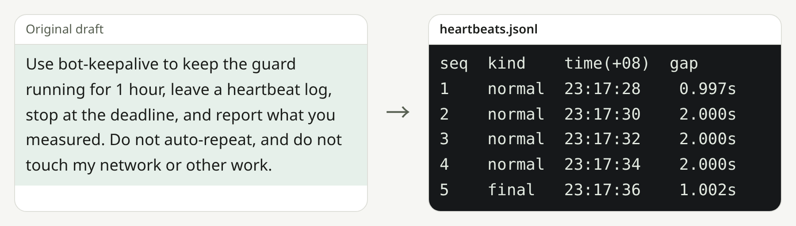

# bot-keepalive

Keep a Grok cloud computer awake for a set time, and leave a heartbeat log.

[简体中文](README.md) · [MIT](LICENSE)

<picture>
  <source media="(prefers-color-scheme: dark)" srcset="docs/readme/hero-dark.png">
  
</picture>

Short run of `scripts/heartbeat_loop.py`: interval 2 seconds, ending with `final`. Normally it writes once a minute until the deadline you set.

## Quick start

```sh
gh repo clone bmdy6/skill-bot-keepalive .agents/skills/bot-keepalive
```

Then tell your agent:

> Use bot-keepalive to keep the guard running for 1 hour.

Requires Python 3 and a skill-capable agent, plus `gh` and a network connection to clone.

## What you get

- **Fewer tool calls.** One hour uses roughly 6–15 agent tool calls instead of about 130.
- **A minute-by-minute log.** `scripts/heartbeat_loop.py` appends one line per minute to `heartbeats.jsonl`.
- **A hard stop and a report.** At the deadline the script writes a `final` line and exits; the agent writes `summary.json` and reports what it measured.

## How it works

1. The agent starts the script, which writes a heartbeat immediately and then every 60 seconds.
2. The agent checks about every 10 minutes and relays about every 30 minutes. If awaiting stops, the machine may sleep.
3. At the deadline the script writes `final` and exits, and the agent writes the report.

## Measured (one 1-hour trial)

| | Per-minute agent heartbeats | Lean mode (this skill) |
|---|---|---|
| Agent tool calls per hour | ~130 | 15 |
| Max gap between heartbeats | 87–234 s across runs | 60 s |
| Heartbeats | 62–66 / hour, all written | 60 / 60, all written |

Usage counters are usually account-wide, so quota comparisons are indicative only.

## Lesson from testing

The agent's await keeps the cloud machine awake, not the script. When the worker stopped awaiting mid-run, the machine froze about 5 minutes later and wrote no heartbeats for ~45 minutes. The skill now requires awaiting in ~10 minute chunks until the deadline.

## Options

| Option | Purpose |
|---|---|
| Duration | The length you authorize; the default request is 1 hour. The deadline does not change unless you extend it. |
| Lean mode | The default. A background script writes heartbeats; the agent checks about every 10 minutes. |
| Per-minute agent heartbeats | Use this only when you ask the agent itself to wake every minute. It costs several times more quota. |


## Optional: auto-heal disconnects

Heartbeats keep the cloud machine awake; the disconnects on the evening of 2026-11-11 were on the network path. That evening `/tmp/tailscaled.log` recorded 8 NAT endpoint changes, and the box-to-Mac DERP path went stale while Mac-to-box still worked. Optional `scripts/netwatch.sh` pings the peer and, after consecutive failures, runs a gentle `debug rebind` and `debug restun` with no quota cost; it never runs `down`/`up` or restarts tailscaled.

Rebind plus restun restored box-to-Mac pings in that incident.

Start it with nohup. A supervisor can rerun the same command if it is missing; the script exits 0 when a copy is already running:

```sh
nohup env TS_CLI=/path/to/tailscale TS_SOCKET=/path/to/ts.sock PEER_IP=100.x.x.x \
  LOG=netwatch.log bash scripts/netwatch.sh >/dev/null 2>&1 &
```

## FAQ and boundaries

**Does it stop the computer from sleeping?** No. It does not promise the machine never sleeps.

**Is the script enough on its own?** No. If the agent stops awaiting, the machine can sleep and no heartbeats are written.

**Does it start again after the deadline?** No. It stops and never auto-repeats.

**Can I attribute the usage change to this run alone?** No. Usage windows are usually shared account-wide.

**Does it change my network or other tasks?** The keepalive loop does not. The optional netwatch may run a gentle rebind and restun after consecutive ping failures; it never runs down/up or restarts tailscaled.

<details><summary>Rights and legal detail</summary>

Released under the MIT License. The skill guides one bounded run, does not guarantee the machine stays awake, and does not attribute usage changes to this run alone.

</details>

## Contributing

Open a reproducible issue or pull request.

## License

[MIT](LICENSE).
