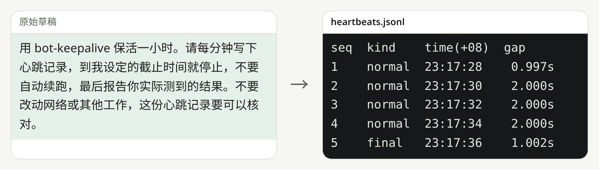

# bot-keepalive

限定时间内维持 Grok 云端电脑醒着，并留下心跳记录。

[English](README.en.md) · [MIT](LICENSE)

<picture>
  <source media="(prefers-color-scheme: dark)" srcset="docs/readme/hero-dark.zh-CN.png">
  
</picture>

短时演示：`scripts/heartbeat_loop.py` 写入 `heartbeats.jsonl`，这里间隔为 2 秒，到截止时间写出 `final`。正常使用时每分钟写一次，直到你设定的截止时间。

## 快速开始

```sh
gh repo clone bmdy6/skill-bot-keepalive .agents/skills/bot-keepalive
```

然后告诉你的 agent：

> 用 bot-keepalive 保活一小时。

需要 Python 3 和能使用技能的 agent；克隆需要 `gh` 和网络。

## 你会得到什么

- **更少的工具调用。** 一小时大约只要 6 到 15 次工具调用，而不是大约 130 次。
- **每分钟一条可核验的心跳记录。** `scripts/heartbeat_loop.py` 每分钟往 `heartbeats.jsonl` 追加一行。
- **到点停止并给出报告。** 到截止时间脚本会写一条 `final` 后退出，agent 再写出 `summary.json`，并报告实际测到的结果。

## 如何工作

1. agent 在后台启动脚本。脚本会马上写第一条心跳，之后每 60 秒写一次。
2. agent 大约每 10 分钟检查一次，大约每 30 分钟接力一次，并且必须一直等待。等停了，云端电脑就可能睡着。
3. 到截止时间后，脚本写出 `final` 并退出，agent 再写出报告。

## 实测（一次一小时）

| | 旧办法：agent 每分钟自己写 | 省额度模式（本技能） |
|---|---|---|
| 每小时工具调用 | 约 130 次 | 15 次 |
| 心跳最大间隔 | 87 到 234 秒（多次运行） | 60 秒 |
| 心跳 | 每小时 62 到 66 次，全部写成功 | 60 次，全部写成功 |

额度一般是整个账户共用的，所以额度对比只能当参考。

## 实测得到的教训

让云端电脑醒着的是 agent 在后台等待，不是脚本。有一轮跑到一半，agent 不再等了，大约 5 分钟后电脑就睡了，中间约 45 分钟一条心跳都没有。所以技能现在要求 agent 每 10 分钟左右等一次，一直守到截止时间。

## 选项

| 选项 | 用途 |
|---|---|
| 时长 | 以你授权的时间为准，默认请求是 1 小时。除非你明确延长，截止时间不会改。 |
| 省额度模式 | 默认做法。后台脚本写心跳，agent 大约每 10 分钟检查一次。 |
| 逐分钟由 agent 写心跳 | 只有在你明确要求 agent 自己每分钟醒来时才用。额度会多花好几倍。 |


## 可选：自动修复断线

心跳只能让云端电脑保持醒着，但 2026-11-11 晚上的断开是网络侧的问题。那天晚上 `/tmp/tailscaled.log` 记录到 NAT 端点变了 8 次，电脑到 Mac 的 DERP 路径变旧了，而 Mac 到电脑仍然通。可选的 `scripts/netwatch.sh` 会定时 ping 对端，连续失败后做一次温和的 `debug rebind` 和 `debug restun`，不消耗额度；它不会执行 `down`/`up`，也不会重启 tailscaled。

那次事件里，rebind 加 restun 恢复了电脑到 Mac 的 ping。

用 nohup 启动即可。如果你已有守护脚本，让它在进程不在时再执行同一条命令；脚本用 flock 保证只跑一份，已有实例时会以状态 0 退出：

```sh
nohup env TS_CLI=/path/to/tailscale TS_SOCKET=/path/to/ts.sock PEER_IP=100.x.x.x \
  LOG=netwatch.log bash scripts/netwatch.sh >/dev/null 2>&1 &
```

## 常见问题和边界

**它能保证电脑永不休眠吗？** 不能。这个技能并不承诺机器永远不睡。

**只跑脚本够不够？** 不够。如果 agent 不再等待，电脑可能睡着，脚本也不会再写心跳。

**到截止时间后会自动再跑吗？** 不会。到点就停，不会自动续跑。

**额度变化能都算在这一次上吗？** 不能。用量窗口通常是整个账户共用的。

**它会改我的网络或其他任务吗？** 保活本身不会。可选的断线修复只会在连续 ping 失败后做温和的 rebind 和 restun，不会 down/up，也不会重启 tailscaled。

<details><summary>权利与法律说明</summary>

本仓库以 MIT 许可证发布。技能只指导一次限定时长的保活，不保证云端电脑保持醒着，也不把用量变化单独归到这一次运行。

</details>

## 参与贡献

请提交可复现的问题或 pull request。

## 许可证

[MIT](LICENSE)。
